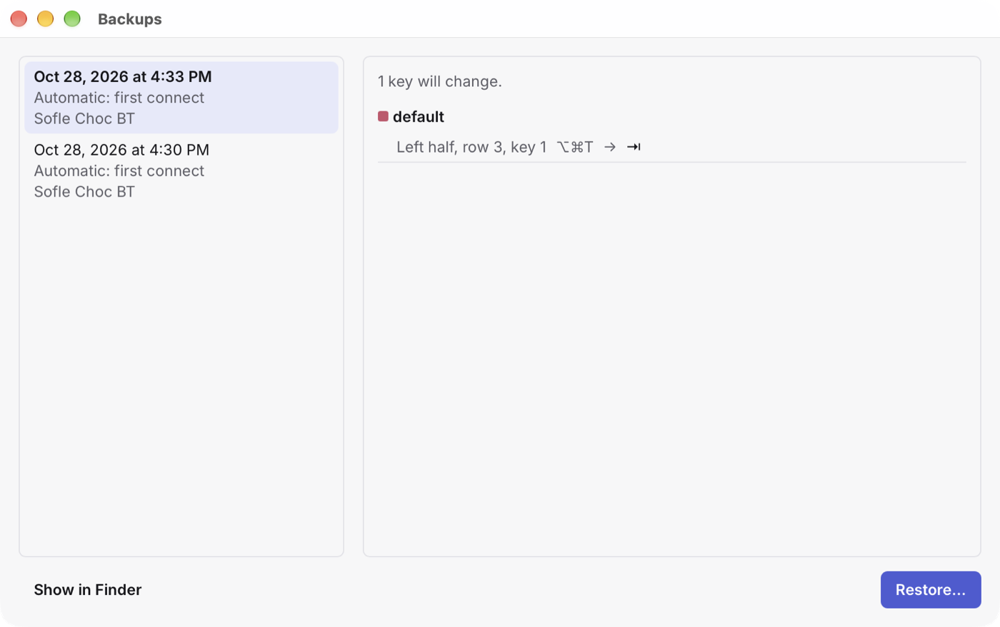

# Backups

Keywright keeps copies of your keymap, so a change you regret is never the end of it. You can also export your keymap to a file of your own, and import it again, on this keyboard or another of the same model.

A backup is a `.keywright` file: plain text, which you can read, keep with your other settings, or compare with `diff` or git.

## Automatic backups

Keywright backs up your keymap by itself:

- the first time it connects to your keyboard, each time Keywright opens;
- before it changes the whole keymap: before importing a backup, restoring the stock settings, or updating firmware.

It keeps the last 20. To keep more or fewer, from 5 to 100, choose **Keywright › Settings… › Backups**. **Show Backups Folder** there opens the folder in Finder: `~/Library/Application Support/dev.zunh.keywright/backups/`.

## The Backups window

Choose **File › Backups…** (⇧⌘B). The list shows each backup's date, why Keywright made it, and the keyboard. Choose one to see how it differs from your keyboard's keymap now:

- **Restore…** shows what restoring it would change, then applies it as changes to try. Nothing is saved until you save.
- **Show in Finder** shows the file.

Your keyboard needs to be connected and unlocked to compare or restore.

## Export and import

- **File › Export…** (⇧⌘E) saves your keyboard's keymap to a file you choose.
- **File › Import…** (⌘O) opens a backup. Double-clicking a `.keywright` file in Finder does the same.

Before importing, Keywright shows what would change, layer by layer, as Review does, and lists anything your keyboard can't take, with why, such as an action its firmware doesn't have. Nothing is left out without saying so. **Apply as Changes** applies the rest as changes to try, after backing up your keymap. Check them on the keyboard, then save them, as with any change: see [Trying, reviewing and saving](changing-keys.md#trying-reviewing-and-saving).

## Going back to the stock keymap

To put one key back as your keyboard came, select it and choose **Restore Stock** at the bottom of the inspector. **Restore Stock Layer**, in a layer's right-click menu, does a whole layer.

To put the whole keyboard back, choose **Keyboard › Restore Stock Settings…**. Your keyboard gets the keymap it shipped with: every key, and the order of the layers. This can't be undone, but Keywright backs up your keymap first, so you can import it again. Layer names stay until the keyboard restarts.

## From the command line

`keywright backup`, `keywright diff` and `keywright restore` do the same from Terminal or a script, with the same files: see [The command line](command-line.md).
