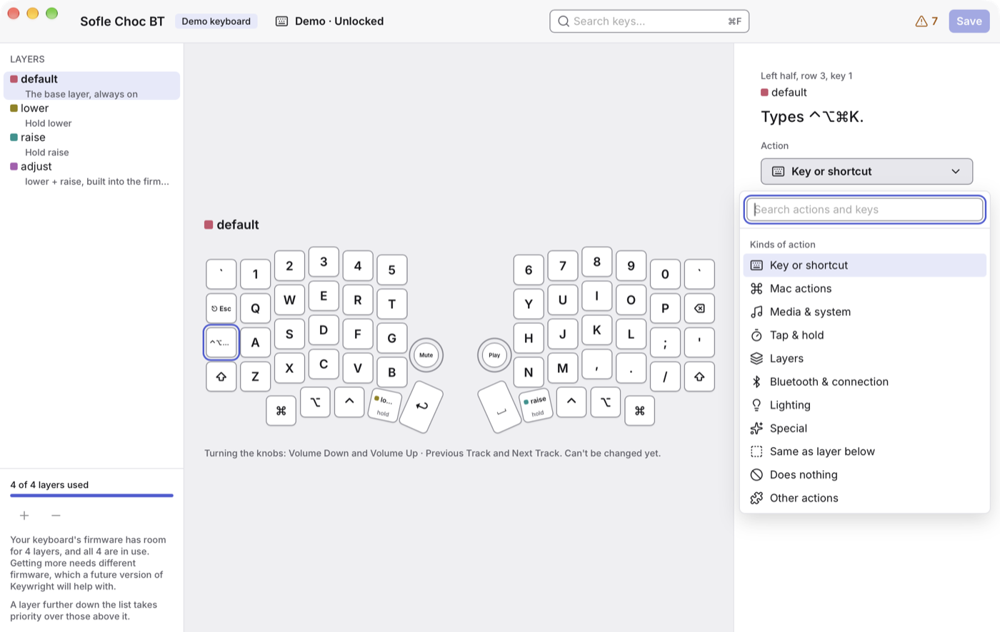
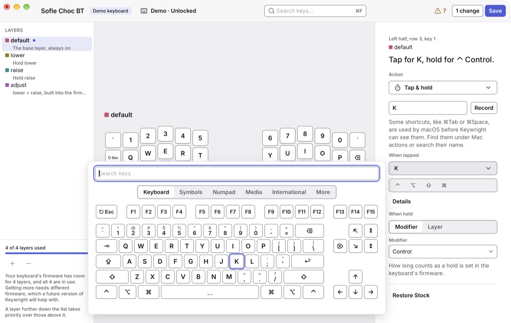
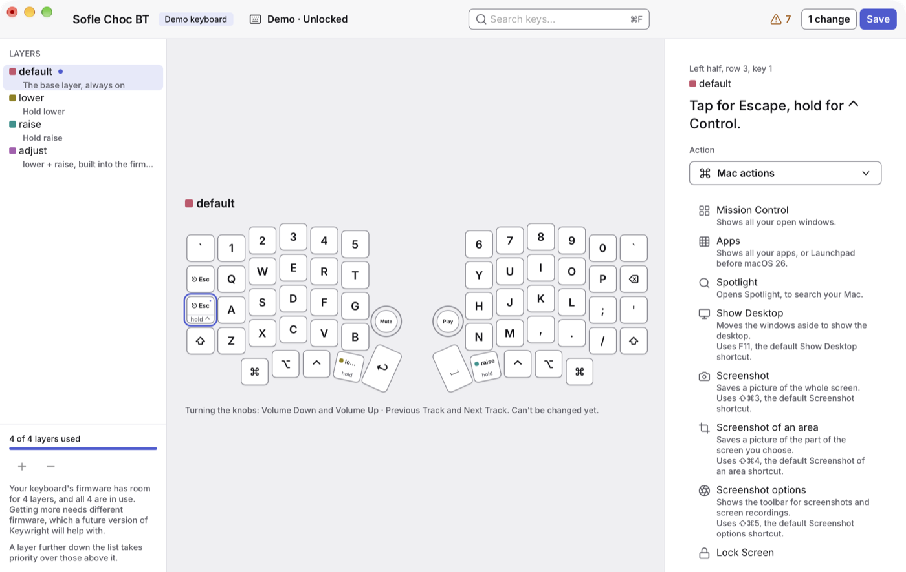
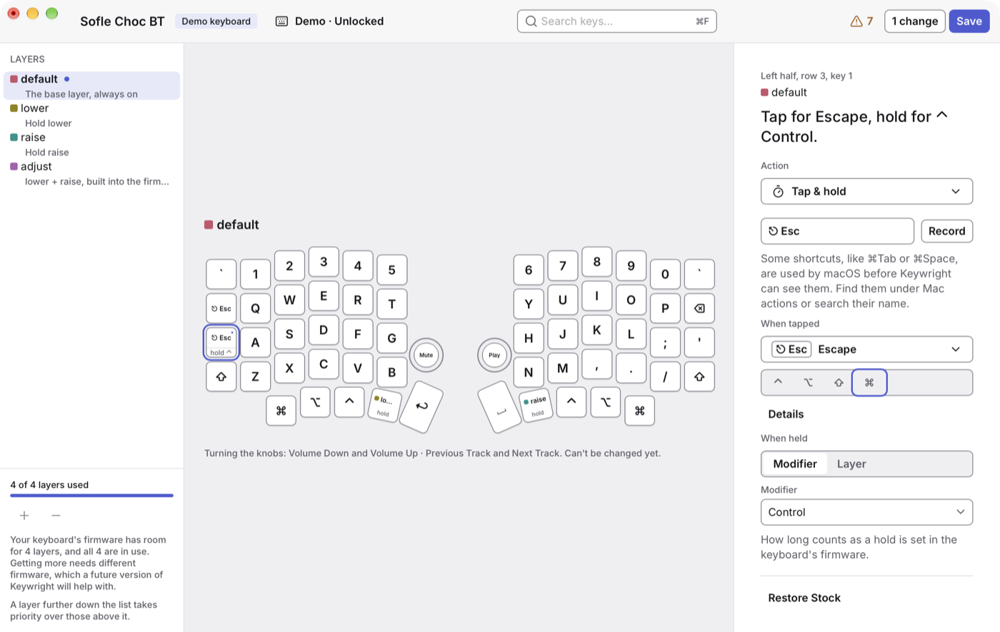

# Changing keys

Every key on every layer does one thing, which Keywright calls its _action_: type a key or a shortcut, do a Mac action, act one way when tapped and another when held, turn a layer on, and so on. This page is about choosing them. [Layers](layers.md) explains the layers themselves.

## The window

- **The toolbar**, at the top: your keyboard's name, the connection button (such as _USB · Unlocked_), search, the ⚠ button while some keys don't work on a Mac, how many changes you're trying, and **Save**.
- **Layers**, on the left: your keyboard's layers, and how to reach each one.
- **The keyboard**, in the middle: the layer shown, drawn as your keyboard is laid out.
- **The inspector**, on the right: what the selected key does, and what to change it to. With no key selected, it describes the layer: press Escape on the keyboard to clear the selection.

⌃⌘S hides or shows the layers, and ⌥⌘0 the inspector. ⌘+ and ⌘− zoom the keyboard, and ⌘0 sets it back.

## Reading the keys

Each key shows what it does when you tap it, as your Mac would type it: with a German or a Russian keyboard layout on your Mac, the keys show its letters. Hover over a key, and its whole sentence shows, such as "Tap for Escape, hold for ⌃ Control."

| You see                             | It means                                                                                      |
| ----------------------------------- | --------------------------------------------------------------------------------------------- |
| `⇧⌘4`                               | A shortcut. Modifiers come in Apple's order: Control (⌃), Option (⌥), Shift (⇧), Command (⌘). |
| A strip at the bottom: `hold ⌃`     | Tap & hold: the key does one thing when tapped, and holds a modifier or a layer when held.    |
| ■ and a layer's name, with `hold`   | A layer key. Its colour is the layer's, as in the layers list.                                |
| A faded label, with ▽ in the corner | Same as layer below: the key does what it does on the layer under this one.                   |
| A hatched key with –                | Does nothing: the key does nothing on this layer.                                             |
| ⋯ in the corner                     | Another action, named the way your keyboard's firmware names it.                              |
| • in the corner                     | You've changed it, and haven't saved it yet.                                                  |
| ⚠ in the corner                     | It doesn't work on a Mac.                                                                     |

To see what keys type in a second keyboard layout as well, such as Russian beside English, choose it in **Keywright › Settings… › Keyboard › Secondary labels**. Keys then show it in their top-right corner.

## Selecting keys

- **Click** a key to select it, and the inspector shows it.
- **⇧-click** selects the keys between the selected one and this one. **⌘-click** adds a key to the selection, or takes it out. Several keys selected change together.
- With the keyboard focused, the **arrow keys** move to the nearest key in that direction, and ⌘A selects every key.

## Choosing an action

In the inspector, the **Action** button names what the key does. Click it, or double-click the key, to choose another kind:

Typing in its search finds any action by name or by what it does, and any key: "copy", "volume", "esc". The actions you chose last come first.

### Key or shortcut

The key types one key, with or without modifiers, such as ⌘C.

- **Record it:** click **Record**, or press **R** with the keyboard focused, then press the shortcut. Keywright records the keys where they are, whatever your keyboard layout. **Escape** cancels; to put Escape itself on a key, choose it from the key picker below. A shortcut that's one of the Mac actions shows its name.
- **Choose the key** from the key picker, and the modifiers with the four buttons ⌃ ⌥ ⇧ ⌘ under it. **Details** chooses whether they're the left or the right modifiers.

Some shortcuts, like ⌘Tab or ⌘Space, are used by macOS before Keywright can see them, so they can't be recorded. Choose them from the key picker instead, or find them under Mac actions.

The **key picker** shows the keys of a Mac keyboard, and more on its tabs: Symbols for the characters programming needs, one click each; Numpad; Media; International; and More, which has every other key ZMK knows. Search finds a key by its name, by what it types, or by what it types with Shift: `!` finds Shift-1.

### Mac actions

One click for things you'd otherwise need a shortcut for: Mission Control, Apps, Spotlight, Show Desktop, screenshots, Lock Screen, Emoji & Symbols, Dictation, switching apps, Copy, Cut, Paste, Undo and Redo, brightness, volume, and music.

Some use one of macOS's default shortcuts, and say so, such as "Uses ⇧⌘3, the default Screenshot shortcut." If you've changed that shortcut in **System Settings › Keyboard › Keyboard Shortcuts**, the action won't work. Keywright lists only the actions checked on your version of macOS.

#### The Globe key

macOS only takes the Globe (🌐) key from Apple's own keyboards. At the end of the Mac actions, **Use This Key as Globe** makes the selected key act as Globe on this Mac, as a change to try. It works while Keywright is running, so turn on **Open at login** in **Keywright › Settings… › General**. **Settings › Keyboard › 🌐 Globe key** shows which key does it, and turns it off.

### Media & system

Play/Pause, next and previous track, volume up, down and mute, and screen brightness.

### Tap & hold

One key, two jobs: it does one thing when you tap it, and another while you hold it. A common one is Escape when tapped, and Control when held, on the key where Caps Lock or Tab is:

- **When tapped:** a key or shortcut, chosen as above.
- **When held:** a **Modifier**, such as Control, or a **Layer**, which is on while you hold the key.

How long counts as a hold is set in your keyboard's firmware: 200 milliseconds on the Sofle's stock firmware, which Keywright can't change yet.

### Layers

A key that turns a layer on: while you hold it, until you switch again, until you press it again, or for the next key only. [Layers](layers.md#layer-keys) explains each.

### The other kinds

- **Bluetooth & connection:** choose one of the keyboard's five Bluetooth devices, go to the next or the previous, forget this device's pairing, or send the keys over USB or Bluetooth.
- **Lighting:** the keyboard's lights: on and off, brightness, colour and effect.
- **Special:** Caps Word, which types the next word in capitals; Repeat, the last key again; Sticky modifier, which holds a modifier for the next key only; Unlock editing; Update mode, for [updating firmware](firmware-updates.md); and Restart keyboard. Keywright asks before it gives a key Update mode, since pressing it stops the keyboard until it gets new firmware.
- **Same as layer below:** the key does what it does on the next layer down. On the base layer, that's nothing.
- **Does nothing:** the key does nothing on this layer, and the layers below don't get it either.
- **Other actions:** whatever else your keyboard's firmware can do, with its own settings.

## Quicker ways

| To                                     | Do                                                                    |
| -------------------------------------- | --------------------------------------------------------------------- |
| Swap two keys                          | Drag one onto the other. Escape cancels the drag.                     |
| Copy a key's action onto another       | Hold Option (⌥) while you drag, or ⌘C on one key and ⌘V on the other. |
| Make a key the same as the layer below | Press **T**.                                                          |
| Make a key do nothing                  | Press **Delete** (⌫). The first time, Keywright asks to be sure.      |
| Put a key back as your keyboard came   | **Restore Stock**, at the bottom of the inspector.                    |
| Everything at once, for a key          | Right-click it.                                                       |

**T**, **R** and **Delete** work while the keyboard has the focus, so they never get in the way of typing in a field.

## Finding a key

Type in **Search keys** (⌘F) to find keys on every layer: "copy", "⌘C", "volume". Keys that don't match fade, and each layer says how many match. **Return** goes to the next match, switching layers as it goes, and **Shift-Return** to the one before. Escape clears the search.

## Changes that would lock you out

Some changes would leave you stuck: removing the only key that unlocks your keyboard, or the only way to reach a layer, or the only way back from one. Keywright doesn't make those straight away. The inspector says what would happen, with **Keep the Old Action** and **Change Anyway**.

## Trying, reviewing and saving

**Every change works on your keyboard at once**, so you can try it. The key gets a •, and the toolbar counts the changes you're trying.

Your keyboard keeps the changes until it restarts or goes to sleep. To keep them for good, **save** them: click **Save**, or press ⌘S. Keywright shows every change first, grouped by layer, as it was and as it is:

- **Revert** takes back one change.
- **Discard All…** takes them all back, after asking: your keyboard goes back to how it was when you last saved.
- **Save to Keyboard** saves them. A note at the bottom of the window says "Saved to keyboard ✓".

**Undo** (⌘Z) and **Redo** (⇧⌘Z) work on every change, saved or not, and the Edit menu names them, such as "Undo Assign ⌘C to B". Undoing a saved change makes it a change you're trying again.

If you quit with changes you haven't saved, Keywright asks whether to save them first.
