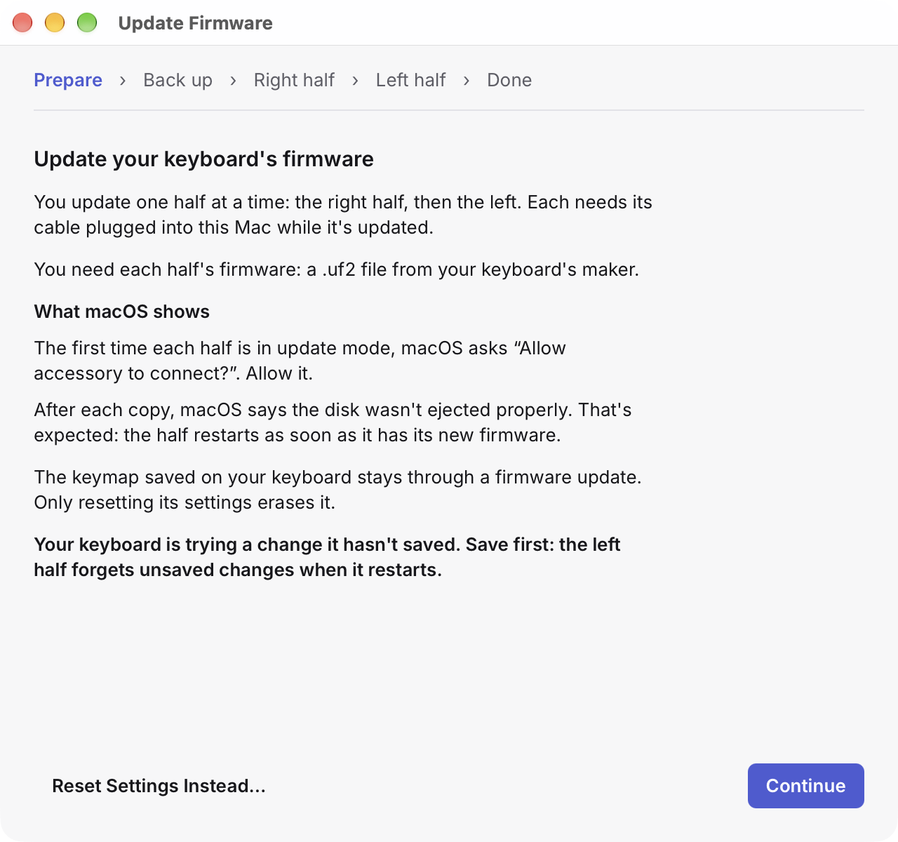

# Updating firmware

Your keyboard's firmware is the software that runs on it. Your keyboard's maker releases new versions from time to time, as `.uf2` files, one for each half. Keywright's Firmware Update assistant puts them on your keyboard, one half at a time, and checks each step.

The keymap saved on your keyboard stays through a firmware update. Keywright backs it up first all the same.

## Before you start

- Get the firmware from your keyboard's maker: a `.uf2` file for each half. For the Sofle, that's [Keebart](https://www.keebart.com).
- Save any changes you're trying: a half forgets unsaved changes when it restarts.
- Have a SIM tool or a paper clip at hand, to press the reset button on each half.
- Have the keyboard's cable: each half is updated over it.

## Update

Choose **File › Update Firmware…**. The assistant goes through its steps in order: **Prepare**, **Back up**, then each half, in the order your keyboard's maker updates them (the right half, then the left, for the Sofle), and **Done**.

1. **Prepare** says what macOS will show. The first time each half is in update mode, macOS asks "Allow accessory to connect?": allow it. After each copy, macOS says the disk wasn't ejected properly: that's expected, because the half restarts as soon as it has its new firmware.
2. **Back up** backs up your keymap, with the keyboard connected and unlocked. If it can't, you can try again, or go on without a backup.
3. **Each half:**
   1. Choose the half's `.uf2` file. If it looks like the other half's file, Keywright says so: **Choose Another File**, or **Use Anyway**.
   2. Plug that half's cable into your Mac, and put the half into **update mode**: on the Sofle, double-press the reset button next to its USB port, with a SIM tool.
   3. The half shows up as a drive, `KEEBART`. Keywright checks it's the right half, and copies the firmware. **Don't unplug the half until the copy is done.**
   4. The half restarts with its new firmware, and Keywright waits for it to come back before it goes on.
4. **Done:** both halves run their new firmware, and your keymap is still on the keyboard.

If something goes wrong, the step says what happened and what to do, and **Try Again** repeats it. A half in update mode stays there until it gets firmware, or you press its reset button once to restart it.

## Reset the settings

If the halves won't talk to each other any more, resetting their settings usually fixes it. Choose **Reset Settings Instead…** on the first step. You need four `.uf2` files from your keyboard's maker: each half's _settings reset_ firmware, and each half's normal firmware.

Resetting makes the keyboard forget the keymap saved on it and its Bluetooth pairings. Keywright backs up your keymap first. After the reset:

1. Switch both halves on. They find each other by themselves; if they haven't after a minute, press both reset buttons at the same time.
2. In **System Settings › Bluetooth**, remove your keyboard, then connect it again.
3. To get your keymap back, choose **File › Backups…**, and restore the backup Keywright made before the reset.

## From the command line

`keywright flash` updates one half from Terminal: see [The command line](command-line.md#flash).
