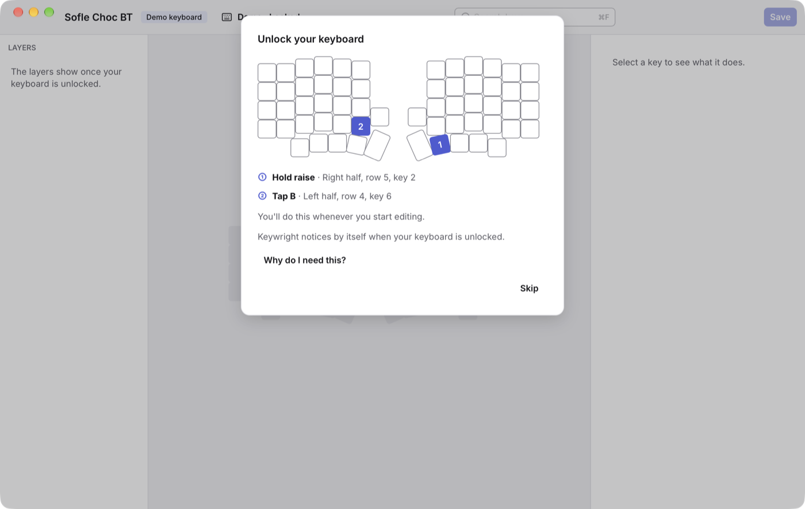
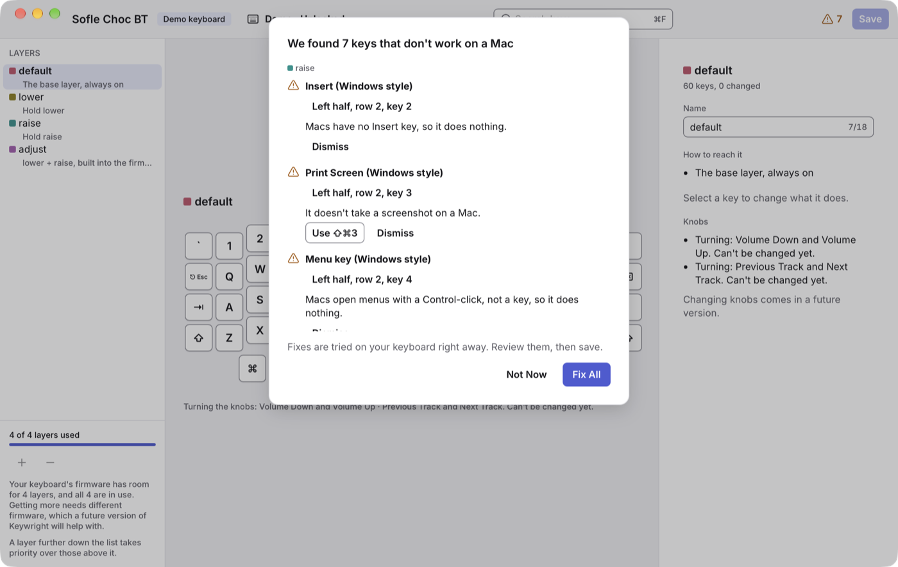
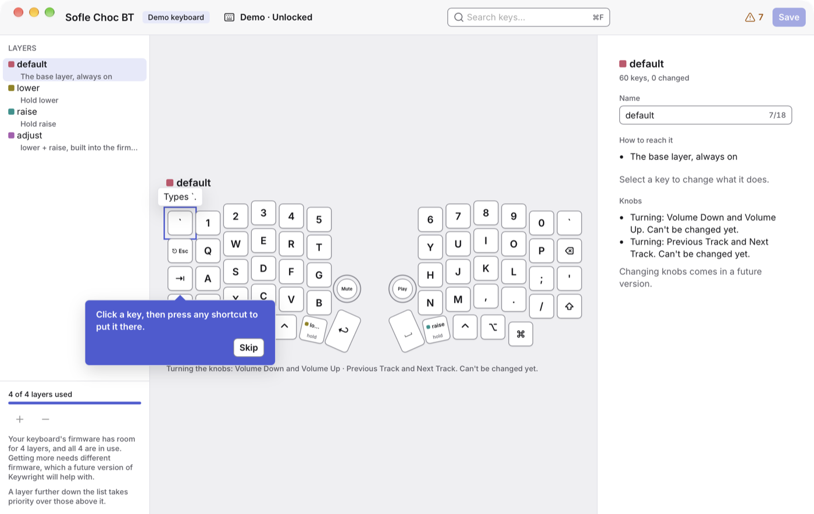
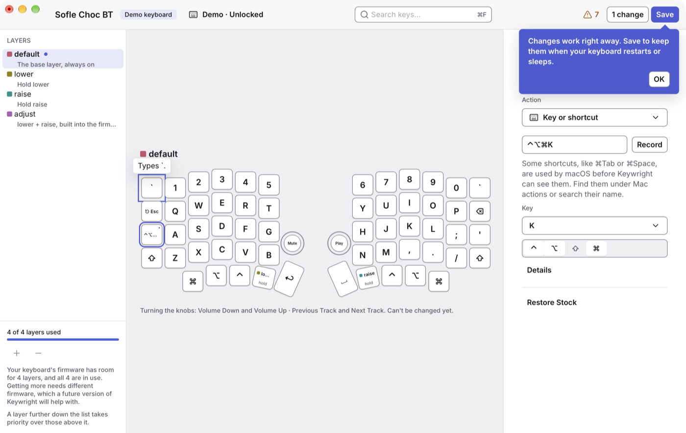
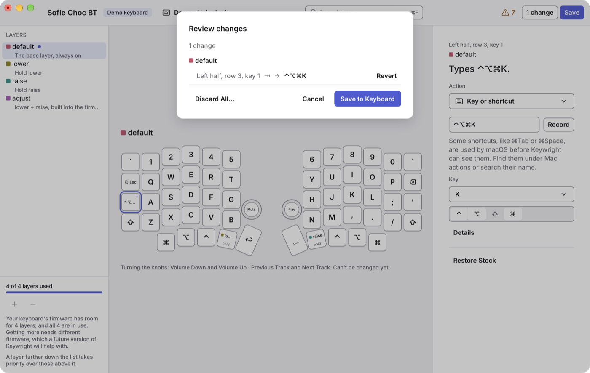
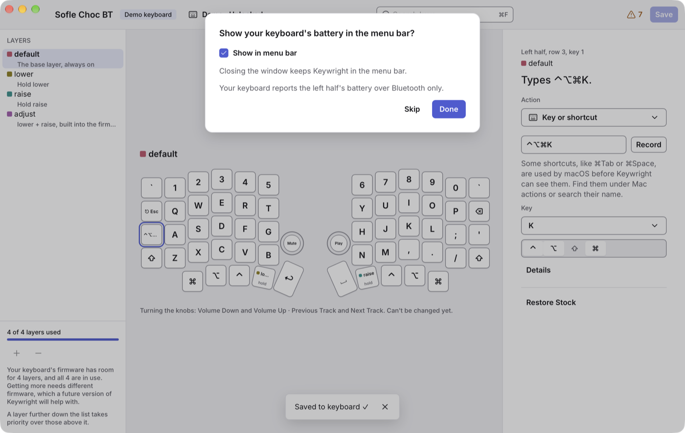

# Getting started

This page takes you from installing Keywright to your first changed key, saved on your keyboard.

## Install Keywright

> Keywright isn't released yet. Until version 1.0 is out, [build it from source](#build-it-from-source).

### Download it

1. On the [Releases page](https://github.com/zunhdev/keywright/releases), download `Keywright-<version>-aarch64-apple-darwin.zip`.
2. Open the zip, and **drag Keywright into Applications with Finder**. Move it before you open it: macOS runs an app it hasn't moved from a temporary copy, which causes problems later.
3. Open Keywright. macOS says it can't check the app, because Keywright isn't signed by Apple. Click **Done**.
4. Open **System Settings › Privacy & Security**, scroll down, and click **Open Anyway** next to "Keywright was blocked". Confirm, and Keywright opens.

If you prefer Terminal, this does the same as steps 3 and 4:

```sh
xattr -dr com.apple.quarantine /Applications/Keywright.app
```

macOS asks you to confirm each new version of Keywright this way, but the permissions you gave it, such as Bluetooth, stay.

To check a download, each release lists the files' checksums in `SHA256SUMS`: `shasum -a 256 -c SHA256SUMS`.

### Build it from source

You need a Mac with Apple silicon and macOS 15 or later.

1. Install [rustup](https://rustup.rs), as its page says, and [mise](https://mise.jdx.dev), for example with `brew install mise`.
2. Get the code, and build it:

   ```sh
   git clone https://github.com/zunhdev/keywright.git
   cd keywright
   mise trust && mise install
   mise run build
   ```

3. Move `target/release/bundle/macos/Keywright.app` into Applications, and open it.

An app you built yourself opens without _Open Anyway_. Each build counts as a new app for macOS, though, so after you build again, Keywright asks for Bluetooth again.

## The first-time setup

The first time Keywright opens, it walks you through five steps: connect, unlock, the Mac check, trying a change, and the menu bar. Each has **Skip**. To go through them again, choose **Help › Run First-Time Setup**.

### 1. Connect your keyboard

Keywright finds your keyboard by itself, over a cable or Bluetooth.

**With a cable:** plug the **left** half into your Mac. On a split keyboard such as the Sofle, only the left half talks to the computer: the right half's port only charges it.

**Over Bluetooth:**

1. Pair the keyboard in **System Settings › Bluetooth**, if it isn't paired yet. To pick one of its five Bluetooth slots, hold **raise** and tap **1** to **5**.
2. The first time, Keywright asks to use Bluetooth: click **Allow Bluetooth…**, then **Allow** when macOS asks. Keywright uses it to edit your keyboard and read its battery.

Keywright edits your keyboard over the connection it's typing over. With both a cable and Bluetooth, that's usually the cable. Unplug the cable, and Keywright moves to Bluetooth by itself.

### 2. Unlock it

Your keyboard protects its layout from other apps, so it has to be unlocked before Keywright can change it. The unlock sheet shows which keys to press:



On the Sofle, **hold raise**, the right half's thumb key beside the big Space key, and **tap B**. Both halves need to be on, since raise is on the right half. Keywright notices by itself when the keyboard is unlocked.

It stays unlocked until it's idle for 10 minutes, or reconnects. When it locks itself, a banner says so, and **Unlock…** shows the keys again. You'll unlock it whenever you start editing.

### 3. The Mac check

Some keys in a keyboard's stock keymap do nothing on a Mac, such as Insert, or Copy and Paste the way Linux has them. Keywright lists them, with a Mac replacement where there is one, such as ⇧⌘3 for Print Screen:



**Fix All** tries every replacement on your keyboard. **Not Now** leaves the keys as they are. Either way, the ⚠ button in the toolbar keeps the list, so you can come back to it.

### 4. Change your first key

A callout points at a key, and asks you to try a change:



1. **Click a key**, such as the Tab key.
2. **Press the shortcut** you want it to send, such as Control-Option-Command-K (⌃⌥⌘K). The key shows it, and it works on your keyboard right away: try it.
3. **Save it.** Changes work at once, but your keyboard forgets them when it restarts or sleeps, until you save them. Click **Save** in the toolbar, or press ⌘S.



Save shows you every change first. Click **Save to Keyboard**:



Outside the first-time setup, a click only selects a key. Then press **R**, or click **Record** in the inspector on the right, to record a shortcut. [Changing keys](changing-keys.md) has the other kinds of action.

### 5. The menu bar

Keywright can show your keyboard's battery in the menu bar:



With it on, closing the window keeps Keywright running in the menu bar. With it off, closing the window quits Keywright. You can change it later in **Keywright › Settings… › General**.

Your keyboard reports its battery over Bluetooth only, and for its left half only.

## Exploring without a keyboard

On the screen that asks you to connect your keyboard, **Explore Without a Keyboard** starts the demo keyboard: a Sofle that Keywright simulates, already unlocked. Everything works on it, and saving changes only it. The toolbar says _Demo keyboard_. To stop, click the connection button beside the keyboard's name, **Demo · Unlocked**, then **Leave Demo**.

## Updating Keywright

Download the new version, and drag it into Applications with Finder, replacing the old one. macOS asks you to confirm it with **Open Anyway** again, once. Your settings, backups and permissions stay.
