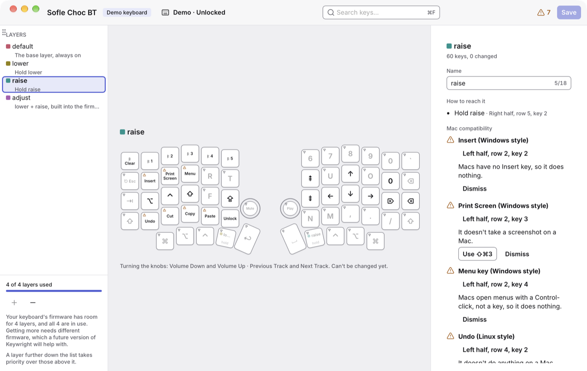

# Layers

A small keyboard does more than its keys can show by having **layers**: whole sets of keys, one on top of another. The **base layer** is what your keys do with no layer keys held. Other layers are on while you hold a layer key, or until you turn them off, and then their keys do something else, such as numbers or arrows.

The Sofle comes with four:

| Layer       | How to reach it                                                      |
| ----------- | -------------------------------------------------------------------- |
| **default** | The base layer, always on.                                           |
| **lower**   | Hold lower, on the left thumb.                                       |
| **raise**   | Hold raise, on the right thumb.                                      |
| **adjust**  | Hold lower and raise together. Your keyboard's firmware turns it on. |

## The layers list

The list on the left shows each layer: its colour, its name, a • while you're trying changes on it, and how to reach it. Click a layer to show it, or press ⌘1 to ⌘9.

With no key selected, the inspector describes the layer shown (press Escape on the keyboard to clear the selection): its name, every way to reach it, its keys that don't work on a Mac, and anything wrong, such as no key turning it on.

On a layer, a key that's **the same as layer below** shows faded, with ▽: it does what the layer under it does. On raise, for example, the letters fade, because they type the base layer's letters. A key that **does nothing** is hatched, and stops the key on this layer.

When two layers are on, the one further down the list wins: its keys come first, and its "same as layer below" keys let the layer above show through.

## Layer keys

A key turns a layer on in one of four ways, which its keycap shows under the layer's name:

| Mode         | The layer is on…                                     | ZMK calls it |
| ------------ | ---------------------------------------------------- | ------------ |
| **Hold**     | while you hold the key.                              | Momentary    |
| **Switch**   | from now on: it's the active layer until you switch. | To layer     |
| **Toggle**   | until you press the key again.                       | Toggle       |
| **Next key** | for the next key you press only.                     | Sticky layer |

To make one, select a key, then choose **Layers** in the action picker, the mode, and the layer. A **tap & hold** key can turn a layer on while it's held, too, and type something when tapped: see [Tap & hold](changing-keys.md#tap--hold).

Adjust is different: the firmware turns it on while lower and raise are both on. Keywright shows that, but can't change it yet.

## Organising layers

- **Rename:** double-click a layer, press Return on it, or right-click it and choose **Rename**. A counter shows how much room is left: 18 letters in English, fewer in other scripts. Return, or clicking elsewhere, renames it; Escape keeps the old name.
- **Reorder:** drag a layer by its handle, which shows when you point at it. The base layer stays first.
- **Add:** **+** under the list adds a layer, while there's room.
- **Remove:** **−** removes the layer shown, or right-click a layer and choose **Remove**. If keys turn it on, Keywright lists them and asks first. ⌘Z brings it back. The base layer can't be removed.
- **Restore Stock Layer**, in a layer's right-click menu, puts its keys and name back as your keyboard came.

Like every change, these work on your keyboard at once, and need saving to stay: see [Trying, reviewing and saving](changing-keys.md#trying-reviewing-and-saving).

## How many layers

Your keyboard's firmware decides how many layers it has room for. The bottom of the list says so, such as "4 of 4 layers used". The Sofle's stock firmware has room for 4, and they're all in use, so to add a layer, remove one first. Getting more needs different firmware, which a future version of Keywright will help with.

## Changes that would strand you

Keywright stops a change that would leave a layer with no key to reach it, or no way back to the base layer once it's on. It says what would happen, with **Keep the Old Action** and **Change Anyway**. A layer that has a problem like that already gets ⚠ in the list, and the inspector explains it.
